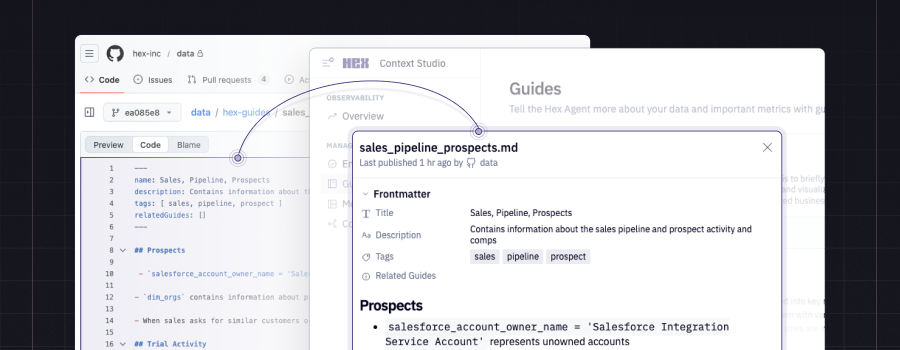

<!-- markdownlint-disable MD041 -->



# Hex Action context toolkit

An action to upload external sources of context to [Hex](https://hex.tech) for use in the Hex Agent for [self-serve analytics](https://learn.hex.tech/docs/explore-data/threads).

This action supports uploading guides and semantic projects to Hex. Read [the docs](https://learn.hex.tech/docs/agent-management/context-management/guides#when-to-use-the-guide-library) on how to best utilize guide files in your Hex workspace. You can learn more about the types of context you can add to Hex in our agent management [docs](https://learn.hex.tech/docs/agent-management/context-management/overview).

## Features

- Selectively upload files in a larger repository
- Preview and test changes on GitHub Pull Requests
- Automatically reflect changes in Hex

## Usage

```yml
name: Publish Hex context

on:
  push:
    branches: ["main", "master"]
  pull_request:

permissions:
  contents: read
  pull-requests: write

jobs:
  publish_hex_context:
    runs-on: ubuntu-latest
    steps:
      - name: Checkout
        uses: actions/checkout@v6
      - name: Upload context resources
        uses: hex-inc/action-context-toolkit@v2
        env:
          GITHUB_TOKEN: ${{ github.token }}
        with:
          token: ${{ secrets.HEX_API_TOKEN }}
          comment_on_pr: true
```

### Inputs

`token`  
_Required._  
_A workspace token with the necessary scopes. This should be set in your GitHub repository settings in Secrets. This can be generated in your Hex Settings. The scopes are "Guides: Read, Guides: Write, Semantic layer sync", respective to what you are configuring._

`config_file`
_Optional._

The path to a context configuration file. When omitted, the Hex CLI discovers `hex_context.config.json`, `hex_context.config.yaml`, or `hex_context.config.yml` in the repository root.

`hex_url`
_Optional. Defaults to_ `https://app.hex.tech`_._
The base URL for your Hex workspace. For most Hex users, this will be `https://app.hex.tech`. For single tenant, EU multi tenant, and HIPAA multi tenant customers, replace `app.hex.tech` with your custom URL (e.g. `atreides.hex.tech`, `eu.hex.tech`).

`comment_on_pr`
_Optional. Defaults to_ `false`_._
Whether to comment on pull requests with a summary of changes and a link to the context preview. Requires a `GITHUB_TOKEN` in the environment variables and the `pull-requests: write` permission (otherwise, can be omitted).

## Configuration file

The action uses a `hex_context.config.json`, `hex_context.config.yaml`, or `hex_context.config.yml` file to define the paths to your guides and semantic projects.

### Guides

There are 2 different ways to point to guides: paths or patterns.

- `path` - the path to a single file.
  - `{ "path": "guides/arr.md" }`
  - Optionally, specify `"hexFilePath"` if you want the path that shows up in Hex to be different than how the file is structured in your repository.
- `pattern` - a glob that matches multiple files
  - `{ "pattern": "guides/*.md" }` matches all `.md` files directly inside a `guides` folder.
  - `{ "pattern": "guides/**/*.md" }` matches files in subdirectories.
  - Optionally, specify `"transform": { "stripFolders": true }` to rewrite the uploaded path to only include the file name, ignoring the folder path (e.g. `folder1/folder2/guide.md` becomes `guide.md`).

### Semantic projects

You can sync semantic project definitions from your repository. Each entry requires:

- `id` - the semantic project ID from your Hex workspace
- `path` - path to the directory containing the semantic model and view files

To convert an external source before uploading, point `path` to the source file and add `convert.from`. Supported source formats are `ossie` (an Ossie YAML file) and `dbt` (a dbt `semantic_manifest.json`). Create the destination semantic project in Hex first, then use its UUID as `id`.

```yaml
semanticProjects:
  - id: "<semantic-project-uuid>"
    path: semantic/b2b_demo.ossie.yaml
    convert:
      from: ossie
```

For dbt, replace the entry with:

```yaml
semanticProjects:
  - id: "<semantic-project-uuid>"
    path: target/semantic_manifest.json
    convert:
      from: dbt
```

Both formats accept an optional `convert.dialect` to select the SQL expression dialect for the Hex exporter. The action installs Hex CLI `1.2026.11.04` when `hex` is not already on PATH. An existing installation is reused, so workflows that install the CLI separately must provide a compatible version. GitHub Actions sets `CI=true`, which the CLI uses to approve downloading conversion tooling. Conversion runs locally before upload; a conversion error fails the action.

With `comment_on_pr: true`, failed previews update the PR comment with their error and conversion problems while keeping the action failed. Successful preview comments include each source's conversion outcome and expandable diagnostics, including warnings and problem causes.

CLI `1.2026.11.04` omits successful converter diagnostics from preview JSON, so the action runs a separate local diagnostics pass after a successful preview, only when PR comments are enabled. This repeats conversion with the same source and dialect without uploading its generated files. Temporary output is removed afterward. A failure to collect these additional diagnostics is reported separately in the comment and does not invalidate the successful preview.

To retain generated files and detailed conversion diagnostics locally, run the standalone converter:

```sh
hex context semantic-project convert --from ossie --to hex \
  --input semantic/b2b_demo.ossie.yaml --output converted/ossie --yes --json -vv \
  > ossie-conversion.json
hex context semantic-project convert --from dbt --to hex \
  --input target/semantic_manifest.json --output converted/dbt --yes --json -vv \
  > dbt-conversion.json
```

The JSON includes `output`, `stdout`, `stderr`, and `exitCode`, including converter diagnostics on failure. The command also exits with the converter's exit code. Config-driven previews use temporary conversion directories that the CLI removes after preparing the upload.

### Example config

```json
{
  "guides": [
    {
      "path": "path/to/my/guide.md"
    },
    {
      "path": "path_i_want_to_change.md",
      "hexFilePath": "path/that/will/show/up/in/hex.md"
    },
    {
      "pattern": "guides/*.md",
      "transform": {
        "stripFolders": true
      }
    },
    {
      "pattern": "guides/**/*.md"
    }
  ],
  "semanticProjects": [
    {
      "id": "<semantic-project-uuid>",
      "path": "path/to/dir"
    }
  ]
}
```

## Migrating from v1 to v2

The action now installs and uses the Hex CLI. No additional installation step is required.

Add a `"semanticProjects"` key to your Hex context configuration file following the [instructions](#semantic-projects) above.

(Breaking) The `publish_guides` input has been removed. Publishing now always occurs on push events to your default branch(es) (usually `main` or `master`). Existing workflows that omitted the input or set it to `true` will continue to work unchanged. A value of `false` is no longer supported.

(Breaking) The `delete_untracked_guides` input has been removed. Guide pruning is now always enabled. Existing workflows that omitted the input or set it to `true` continue to work unchanged. A value to `false` is no longer supported.
